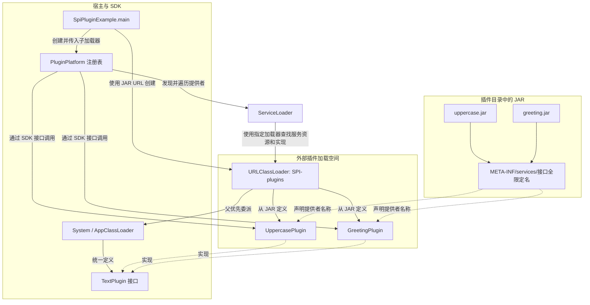
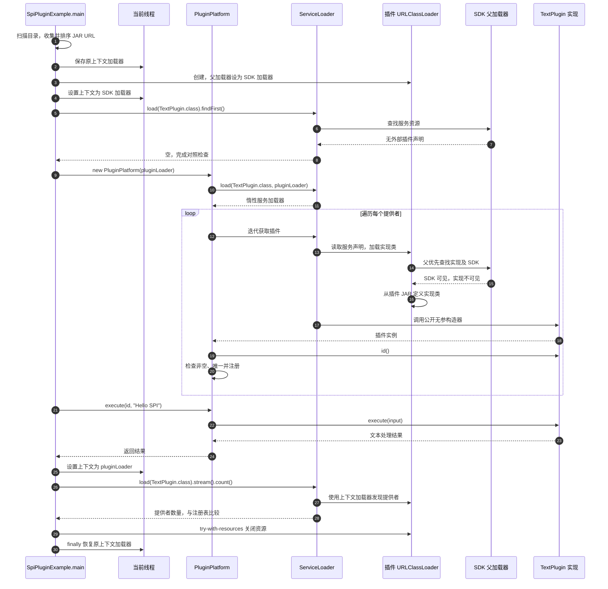
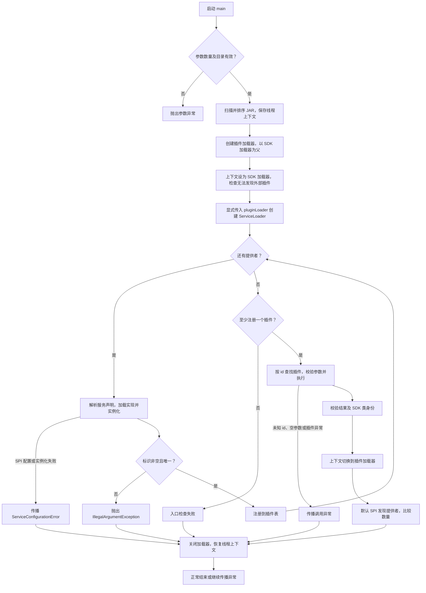

# 案例二：Java SPI SDK 与插件平台

本案例使用 JDK 21 的 `ServiceLoader` 和 `URLClassLoader`，将 SDK、宿主、两个插件分别编译，插件作为独立 JAR 接入。无需 Maven，无脚本，与 Tomcat 案例没有代码依赖。

## 角色与加载关系

```text
System / AppClassLoader
├── SDK：TextPlugin
├── 宿主：PluginPlatform、SpiPluginExample
└── 子加载器 SPI-plugins（URLClassLoader，父优先）
    ├── uppercase.jar → UppercasePlugin
    └── greeting.jar  → GreetingPlugin
```

SDK 是插件开发者与平台共同遵守的接口；SPI 是“实现接口 + 声明提供者 + 运行时发现”的扩展机制。宿主只依赖 SDK，不直接引用具体实现，不需要修改宿主代码来接入新插件。

插件和宿主必须使用同一个 `TextPlugin` 类身份。子加载器通过父优先找到父加载器中的 SDK，避免两个加载器各定义一份接口导致类型不兼容。插件 JAR 不重复打包 SDK。

与第一个案例不同，本例不重写 `loadClass`。SPI 并不自动改变双亲委派规则：`ServiceLoader` 使用指定的加载器（默认重载使用线程上下文加载器）查找服务资源并加载实现，从而让宿主代码能够调用子加载器可见的插件。

## 架构图

实线表示调用、加载或委派关系，虚线表示实现契约或 SPI 声明。SDK 只由父加载器定义，两个插件共享一个子加载器。



## 加载与调用时序图

以下按 `SpiPluginExample.main` 的执行顺序展开。`ServiceLoader.load` 创建发现器，构造器中的遍历才触发插件实例化；后面的 `stream().count()` 统计提供者，不调用 `Provider.get()`，不会为这次统计重新实例化插件。



时序图展示正常路径。加载或调用出现异常时，仍会关闭已创建的插件加载器，并在 `finally` 中恢复线程上下文。

## 插件发现与执行流程图

流程图突出实际入口和注册表中的判断。重复标识由平台拒绝，SPI 声明或实现损坏由 `ServiceLoader` 抛出错误；空目录对应的“无插件”检查在演示入口中。



图中列出主要失败路径；其余检查失败同样遵循 `try-with-resources` 和 `finally` 的清理规则。插件开发接入顺序为：实现 SDK → 编写服务声明 → 单独编译打包 → 放入插件目录 → 重启宿主发现，详见下文“新插件接入步骤”。

## 文件布局

- `sdk/`：接口及中文包说明，单独编译成 `sdk.jar`。
- `host/`：插件注册表、main 演示入口。
- `plugins/uppercase/src/`：大写插件源码，使用 `Locale.ROOT` 避免大小写转换受默认地区影响。
- `plugins/greeting/src/`：问候插件源码。
- 各插件的 `resources/META-INF/services/`：Java SPI 服务注册文件。

注册文件名必须是接口全限定名：

```text
META-INF/services/com.advance.javabasic.spiplatform.sdk.TextPlugin
```

内容是实现类全限定名，例如：

```text
com.advance.javabasic.spiplatform.plugins.uppercase.UppercasePlugin
```

文件使用 UTF-8，一行一个提供者；不是 Java 源码。类路径模式下实现类必须实现接口，且提供公开无参构造器。`ServiceLoader.load` 返回惰性服务加载器，遍历时才创建插件实例；每个 ServiceLoader 有自己的缓存，不是全局单例。本例不使用 JPMS 的 `uses/provides`。

## 手动构建

从 `java-basic` 目录执行，确保 `java`、`javac`、`jar` 都来自 JDK 21。以下是手动命令，不需要创建脚本。

```bash
mkdir -p out/spiplatform/plugins
javac -g -encoding UTF-8 --release 21 -d out/spiplatform/sdk src/com/advance/javabasic/spiplatform/sdk/*.java
jar --create --file out/spiplatform/sdk.jar -C out/spiplatform/sdk .
javac -g -encoding UTF-8 --release 21 -cp out/spiplatform/sdk.jar -d out/spiplatform/host src/com/advance/javabasic/spiplatform/host/*.java
javac -g -encoding UTF-8 --release 21 -cp out/spiplatform/sdk.jar -d out/spiplatform/uppercase src/com/advance/javabasic/spiplatform/plugins/uppercase/src/com/advance/javabasic/spiplatform/plugins/uppercase/*.java
jar --create --file out/spiplatform/plugins/uppercase.jar -C out/spiplatform/uppercase . -C src/com/advance/javabasic/spiplatform/plugins/uppercase/resources .
javac -g -encoding UTF-8 --release 21 -cp out/spiplatform/sdk.jar -d out/spiplatform/greeting src/com/advance/javabasic/spiplatform/plugins/greeting/src/com/advance/javabasic/spiplatform/plugins/greeting/*.java
jar --create --file out/spiplatform/plugins/greeting.jar -C out/spiplatform/greeting . -C src/com/advance/javabasic/spiplatform/plugins/greeting/resources .
```

更新已有源码可以重编译；删除或重命名类时应先清理该插件的旧编译输出，避免旧类残留在 JAR 中。

## main 运行与接入实验

```bash
java -cp out/spiplatform/host:out/spiplatform/sdk.jar com.advance.javabasic.spiplatform.host.SpiPluginExample
```

Windows 将类路径分隔符 `:` 换为 `;`。工作目录也可设为仓库根目录，此时命令行类路径相应加上 `java-basic/` 前缀；无参数 main 会自动寻找默认插件目录。

默认输出包含 `uppercase => HELLO SPI`、`greeting => 你好，Hello SPI`，最终打印 `SPI 案例全部检查通过。`。不依赖插件发现或输出顺序。

要观察动态接入，可建立另一个目录，仅复制 `uppercase.jar` 进去，将该目录作为 main 的唯一参数运行；再加入 `greeting.jar` 并重新启动，就会多发现一个插件，宿主无需重编译。运行期不会自动监控目录变动，本例要求重新启动。

宿主运行类路径中只放宿主和 SDK，不能放插件 JAR 或插件编译输出。否则系统加载器已能发现插件，失去这个实验的对照意义，程序会明确报检查失败。目录为空也会报错，避免把零插件误认为成功。

## 新插件接入步骤

1. 从平台获得 `sdk.jar`，在独立源码目录实现 `TextPlugin`。实现公开无参构造器、唯一非空 `id()` 和符合契约的 `execute()`。
2. 使用 SDK 编译，不依赖宿主实现和其他插件；每个代码包补齐中文 `package-info.java`。
3. 在资源目录创建上述服务文件，填写实现类全限定名。
4. 打包本插件 class 和资源，不包含 SDK。使用 `jar --list --file <插件.jar>` 确认服务文件位于 JAR 根目录的 `META-INF/services` 下。
5. 将 JAR 放入插件目录，重新运行宿主。平台自动发现并按 `id` 注册，重复标识会被拒绝。

## IDE 断点路线

将 SDK 和宿主作为可见源码编译；将 `spiplatform/plugins` 排除出主源码编译范围，使用上述命令单独打包插件。IDE 可用单独模块查看插件源码，但运行配置不得把插件模块输出加入宿主类路径。

入口为 `SpiPluginExample.main`，工作目录为工程根目录或 `java-basic`，程序参数可留空。推荐断点：

1. `new URLClassLoader`：观察 URL 列表、父加载器及 SDK 的定义加载器。
2. `PluginPlatform` 中 `ServiceLoader.load` 和 `for` 循环：比较发现与实例化的时机。
3. 插件的公开无参构造器：观察 ServiceLoader 如何创建实现。
4. `PluginPlatform.execute`：通过接口进入插件实现，观察多态调用。
5. `thread.setContextClassLoader(pluginLoader)` 前后：默认 `ServiceLoader.load(TextPlugin.class)` 从发现零个插件变成发现全部插件；显式传加载器的方式不依赖该线程上下文。
6. `finally`：观察线程上下文恢复，避免长期保留对插件加载器的引用。

## 常见失败与边界

- 无插件：检查服务文件是否打包、目录参数是否正确；插件类存在本身不代表已注册。
- `ServiceConfigurationError`：可能是实现类不存在、不实现 SDK、没有公开无参构造器，或构造器抛异常。此类错误应暴露，平台不静默忽略。
- 未知插件标识、重复标识、空输入：平台显式拒绝；插件业务异常向调用者传播。
- 两个插件共用一个子加载器，不具备插件间依赖隔离。生产平台还需版本兼容、依赖冲突、生命周期和安全策略等设计。
- `ServiceLoader.reload()` 只清理该实例的发现缓存，不会自动替换已定义的类；关闭 URLClassLoader 也不等于类立即卸载。
- 插件是进程内可信 Java 代码，可以执行进程权限范围内的操作，不能把此平台当作不可信代码沙箱。
